# AIの正答率だけでモデルを選んでいないか？
## READY論文に基づく人間のレビュー負荷と運用コストの検証（予備実験）

2026-11-23　／　社内技術共有

凡例：【実測】本実験の結果　【仮定】置いた前提　【論文】READY論文の記述　【探索的】事前登録外の観察

構成：スライド4〜12は予備実験 v1（test 200件）。スライド13〜18は追加実験 v2（モデル比較、test 500件、仮説を事前登録）。スライド19〜22は追加実験 v3（同一モデル内の振り分け信号）。スライド23〜26は追加実験 v4（別モデルによる検証）。スライド27〜29は追加実験 v5（運用構成の総コスト）。スライド30は必要件数の見積もり。**最終的な結論はスライド29**。

---

## 1. 問題提起

- モデル選定は正答率で比べることが多い。
- 実運用では、AIの出力の一部を人間が確認する。運用コストの大半はその人件費。
- 問うべきは「何%正しいか」に加えて、
  - 品質目標を満たすのに、人間が何%を確認すればよいか
  - そのときの総コストはいくらか

---

## 2. READY論文（arXiv:2609.02095、Scale AI、2026-09）

【論文】エージェント単体ではなく「エージェント＋レビュー方針」を評価する。

1. ワークフロー評価：成否と自己申告の確信度を記録
2. 方針の最適化（開発データ）：確信度がしきい値未満を人間へ。目標 Y＋余裕 δ(0.05) を満たす最小レビュー
3. Deployment Qualification（保留データ）：片側95%下限 ≥ Y なら適格

信頼性 R = c·a + (1−c)·a_h（a_h：人間レビューの成功率、仮定）

---

## 3. 論文の主な結果【論文】

- 正答率 72.8% と 72.5% の2システムが、目標76%に 39.2% と 29.6% のレビューを要した。**どちらも適格**で、違ったのはレビュー量。
- 正答率と誤り検出性能（AUROC）の相関 −0.12。
- 点推定では目標を超えても、下限で不適格になるシステムがあった。
- 金額のコスト値は示されていない。

注意：ブログの「判定が正反対」は論文より強い表現。

---

## 4. 独自検証の方法

| 項目 | 内容 |
|---|---|
| データ | BANKING77（銀行問い合わせ77分類、CC BY 4.0） |
| 件数 | 開発 100（train）／最終評価 200（test）、層別抽出 |
| モデル | Claude Opus 5.5 / Sonnet 5.5 / Haiku 5.5（effort=low） |
| 出力 | ラベル＋自己申告の確信度（構造化出力） |
| 方針 | A：AIのみ　B：全件　C：ランダム　D：確信度順 |
| 仮定 | a_h=100%（主）・95%・90%、4,000円/時、2分/件 |

**論文の完全再現ではない**（エージェントではなく単発の分類、件数も少ない）。

---

## 5. 結果① 正答率【実測】

| | Opus | Sonnet | Haiku |
|---|---|---|---|
| 正答率 | 88.0% | 82.5% | 76.0% |
| 95%区間 | 82.8–91.8 | 76.6–87.1 | 69.6–81.4 |
| AUROC（誤り検出） | 0.905 | 0.873 | 0.852 |
| ECE（10ビン） | 0.109 | 0.080 | 0.046 |

- 3組とも有意差（McNemar、Holm補正後 p ≤ 0.011）→ **正答率が近い組は得られなかった**
- ECE が最も良い Haiku が、AUROC では最も低い → 校正と振り分け能力は別物

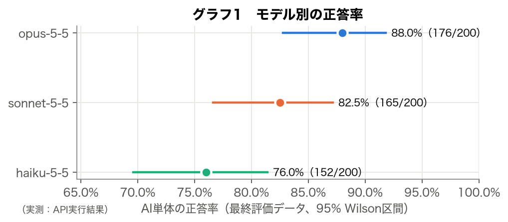

---

## 6. 結果② 必要レビュー率【実測＋仮定】

目標90%（a_h=100%、δ=0.05、しきい値は開発データで決定）

| | Opus | Sonnet | Haiku |
|---|---|---|---|
| レビュー率 | 29.0% | 26.0% | 28.5% |
| 片側95%下限 | 95.5% | 91.1% | 88.8% |
| 判定 | 適格 | 適格 | 保証できない |
| 選定込みブートストラップ平均 | 22.0% | 22.8% | 31.7% |
| 適格になった割合 | 85% | 52% | 41% |

- Opus−Sonnet のレビュー率の差：−0.8pt（95%区間 −17〜+13）→ **差は検出できない**
- 目標95%では Sonnet−Haiku −26pt（−39〜−6）で差あり

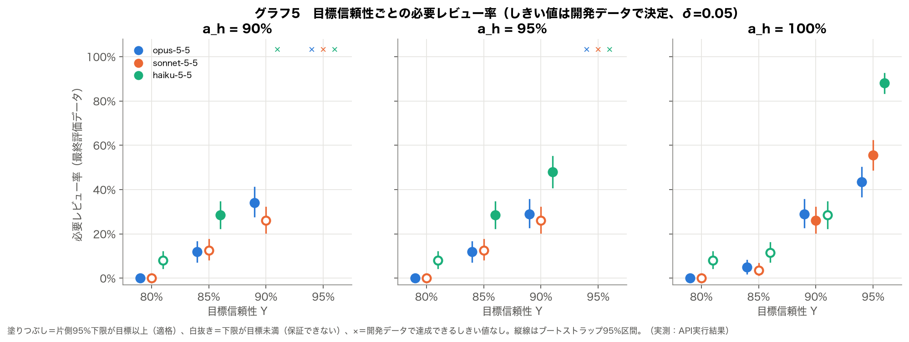

---

## 7. 結果③ レビュー方針【実測】

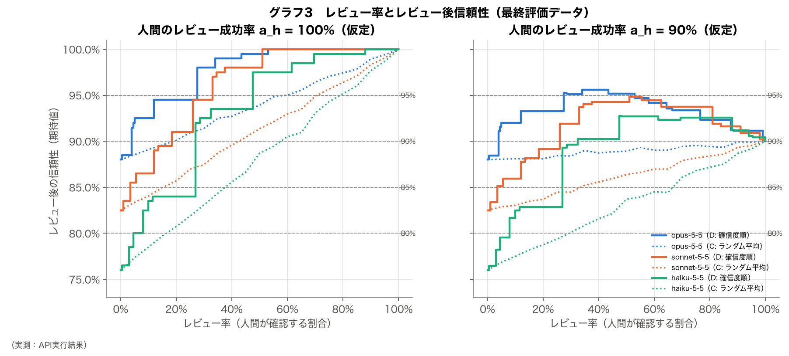

同じレビュー率（目標90%用）でのレビュー後信頼性：

| | ランダム | 確信度順 | 差 |
|---|---|---|---|
| Opus | 91.4% | 98.0% | +6.6pt |
| Sonnet | 87.4% | 94.5% | +7.1pt |
| Haiku | 82.3% | 92.5% | +10.2pt |

---

## 8. 結果④ 総運用コスト【実測＋仮定】

- API費用：0.006〜0.23円/件（キャッシュなしでも最大1.34円）
- 1件レビュー：133円（4,000円/時 × 2分）
- → **総コストはほぼレビュー率で決まる**。API単価40倍の差が総コストに1%も効かない
- 目標90%の1件当たり総コスト：Sonnet 34.8円 < Haiku 38.0円 < Opus 38.9円（差は不確実性の範囲内）
- 目標95%：Opus 58円 < Sonnet 74円 < Haiku 117円

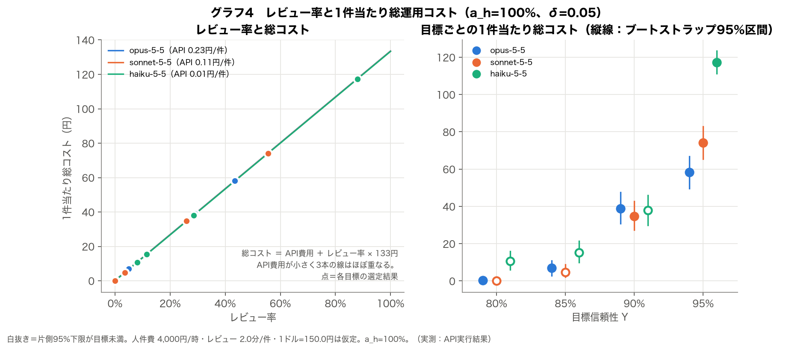

---

## 9. 考察

**確認できた**
- 正答率の差（有意）が、必要レビュー率の差には現れなかった
- 校正の良さ ≠ 誤りを見分ける力
- 総コストはレビュー率でほぼ決まる

**確認できなかった**
- 正答率が近いモデル同士で、レビュー量に差があるか

**差が出なかった理由の候補**
- 件数（誤答24〜48件、レビュー率の区間 ±15pt）
- しきい値選定のばらつき（Opus 目標90%：選定 29.0% 対 事後最小 4.0%）
- 確信度が粗い（17〜21種類の値）

---

## 10. SIer業務への応用

1. 正答率に加え「品質目標での必要レビュー率」を出す
2. 総コストは人件費込みで試算する（API費用はほぼ効かない）
3. 確信度は ECE ではなく AUROC・リスクカバレッジ曲線で評価する
4. しきい値は開発データで決め、別データで1回だけ確認する
5. 保証には数百〜千件規模の保留データが要る
6. 人間レビューの精度と時間を実測する

---

## 11. 結論

- 正答率は3モデルで有意に違ったが、目標90%の必要レビュー率に差は検出できなかった。
- 確信度順のレビューはランダムより 6〜10pt 高い信頼性を出した。
- 総運用コストは人間のレビュー率でほぼ決まった。
- 「正答率だけでなくレビュー率と総コストを評価すべき」という主張と矛盾せず、一部を支持する。
- ただし、正答率が同じモデル間の差は示せていない。モデルの一般的な優劣は断定できない。

---

## 12. 限界と次の検証

**限界**：単発分類・200件・Claude 3モデルのみ・人間側は仮定・Temperature 指定不可・事前学習への混入の可能性

**次の検証**
1. 正答率が近い他社モデルとの組
2. 開発・評価を各500〜1,000件に
3. 振り分け信号の比較（自己申告／複数回一致度／検証モデル）
4. 人間レビューの実測
5. 実業務のエージェントタスクへの拡張

出典：Chatrath et al. (2026) arXiv:2609.02095 ／ BANKING77（PolyAI、CC BY 4.0）

---

## 13. 追加実験 v2 の設計

- 目的：v1 の傾向を仮説（H1〜H6）として**実行前に固定**し、新しいデータで確かめる
- dev 500件（v1 の100件＋400件）、test 500件（**v1 と重複なし**）
- モデル・プロンプト・設定は v1 と同じ。費用 $2.10（累計 $2.87）
- 仮説文書の SHA-256 を実行記録に保存（事後に書き換えていないことを確認できる）

---

## 14. 仮説の判定【実測】

| 仮説 | 判定 |
|---|---|
| H1 正答率 Opus > Sonnet > Haiku（3組とも有意） | 判定保留（Opus−Sonnet +2.2pt、p=0.052） |
| H2 確信度順 > ランダム | **支持**（+6.6〜8.1pt） |
| H3a 目標90%で Opus と Sonnet の差は ±10pt 以内 | 判定保留（−1.5pt、90%区間 −13.0〜+8.8） |
| H3b 目標95%で Haiku が最多 | **支持**（Sonnet より +23pt、Opus より +37pt） |
| H4a Opus・Sonnet は確信度を低めに申告 | **支持**（−9.1pt、−12.4pt） |
| H4b Haiku は ECE が小さいが AUROC は低い | **支持** |
| H5 API費用は全条件で総コストの5%未満 | 不支持（最安の人件費条件かつキャッシュなしで Opus 20.6%） |
| H6 dev 100件のほうがずれ・ばらつきが大きい | 不支持（ばらつきは大きいが、平均的なずれは500件のほうが大きい） |

---

## 15. 必要レビュー率とコスト【実測＋仮定】

目標90%（a_h=100%、δ=0.05）

| | Opus | Sonnet | Haiku |
|---|---|---|---|
| 正答率 | 86.6% | 84.4% | 73.8% |
| 必要レビュー率 | 30.8% | 29.4% | 52.6% |
| 1件当たり総コスト | 41.3円 | 39.3円 | 70.1円 |
| API費用/件 | 0.23円 | 0.11円 | 0.006円 |

- **API単価が最も安い Haiku が、総コストでは最も高い**（約1.7倍）。人件費・時間の12条件すべてで順位は同じ
- 正答率が近い Opus と Sonnet：目標90%では差なし。目標85%（−10.5pt）・95%（−13.6pt）では差が見えた【探索的】

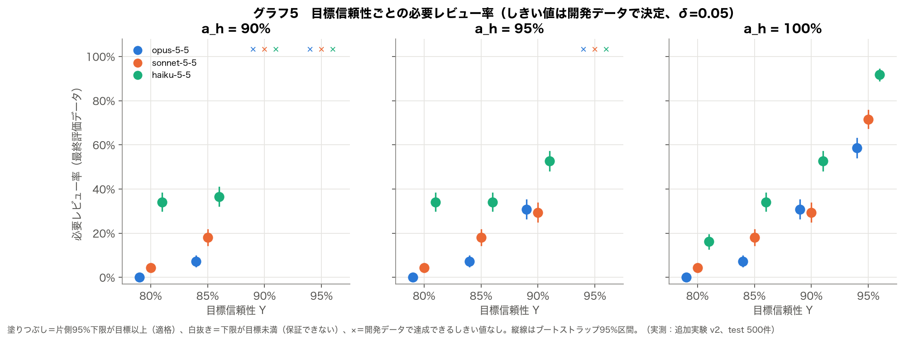

---

## 16. 保証の代償【探索的】

目標90%で、しきい値の選定結果と事後最小レビュー率とのずれ（dev 500件）

| δ | Opus | Sonnet | Haiku | 適格率 |
|---|---|---|---|---|
| 0 | −0.5pt | −0.7pt | 0.0pt | 0〜7% |
| 0.05 | +17.5pt | +8.1pt | +16.8pt | 92〜100% |

- δ=0：ほぼ最適なレビュー率を選べるが、統計的な保証はほとんど通らない
- δ=0.05：保証は通るが、6〜18pt の追加レビューが要る
- v1 で見えた過剰レビューの主因は件数ではなく安全余裕だった

---

## 17. 考察（v2 を踏まえて）

- 確信度順レビューの効果、校正と振り分け能力の不一致は、新しいデータでも再現した
- 総コストを決めるのは API 単価ではなく必要レビュー率
- 論文の中心的な観察（正答率がほぼ同じでレビュー率が違う）は、事前登録した形では示せなかった
  - 確信度が粗く（約20種類の値）、しきい値1段で10pt以上跳ぶ
  - 目標95%（δ=0.05）は「開発データで誤答ゼロ」を求める極端な条件
- v1（200件）は Haiku のレビュー負荷を過小評価していた → 小規模評価での選定は危うい

---

## 18. 結論

- 確信度順のレビューは、同じ人手でランダムより 6.6〜8.1pt 高い信頼性を出した
- API単価が最も安いモデルが、目標90%では総コスト最高（約1.7倍）になった
- 校正の良さ ≠ 誤りを見分ける力
- 統計的な保証には余裕が要り、その分レビューが増える
- 「正答率だけでなくレビュー率と総コストを評価すべき」という主張はおおむね支持される
- ただし、正答率がほぼ同じモデル間の差は事前登録した形では示せていない。モデルの一般的な優劣は断定できない

**次の検証**：正答率が近い他社モデルとの比較（目標90%の差を事前登録）、確信度の取り方の比較、安全余裕の決め方、人間レビューの実測

---

## 19. 追加実験 v3：同じ予測で、振り分け信号だけを変える

- 各モデルの予測を固定 → **正答率は構造上まったく同じ**。違うのは振り分けだけ
- 信号：自己申告／一致度（追加4回の分類との一致）／自己検証（別呼び出しで「正しい確率」）／組み合わせ（3つの平均）
- 下限法（開発データの片側下限で直接選ぶ）と δ=0.05 法も比較
- test は v1・v2 と重複しない500件。費用 $12.56（上限を承認を得て $30 に）

---

## 20. v3 の判定【実測】

| 仮説 | 判定 |
|---|---|
| H1 AUROC：組み合わせ > 自己申告 | 判定保留（差 +0.002〜+0.006） |
| H2 必要レビュー率：組み合わせ < 自己申告（主仮説） | 判定保留（Opus −7.3pt、Haiku −9.9pt、区間は0をまたぐ） |
| H3 AUROC：一致度 > 自己申告 | 不支持（−0.24〜−0.34） |
| H4 AUROC：自己検証 ≒ 自己申告 | **支持** |
| H5 下限法は少ないレビューで適格率90%以上 | 判定保留（−7〜−16pt だが適格率66〜86%） |
| H6 組み合わせは追加費用込みで総コスト減 | **支持（点推定）**（Opus 36.8→17.6円） |

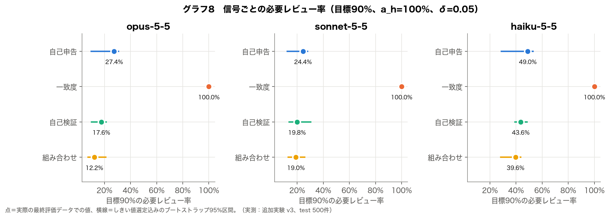

---

## 21. v3 で分かったこと

- 同じモデルを繰り返し呼んでも答えはほぼ同じ（97〜99%）→ 一致度は信号にならない
- 聞き直し（自己検証）は自己申告と同じ情報しか持たない
- 組み合わせ信号は AUROC が同じでも、値が細かくなり（20種類→70〜86種類）、段差による過剰レビューが減る傾向【探索的】
- 開発データの下限だけで選ぶと、別データでの保証は66〜86%しか通らない
- 保証の代償：事後最小 Opus 1.4% に対し、δ法の選定は 27.4%【探索的】

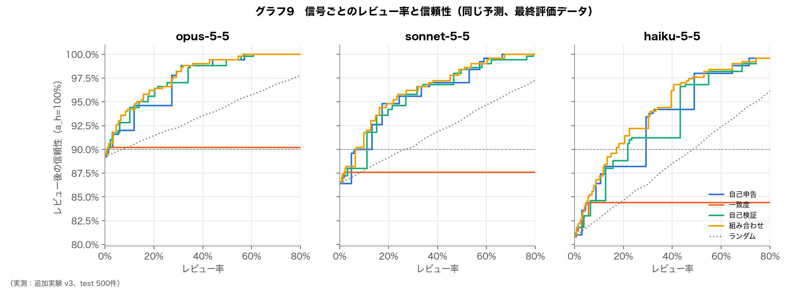

---

## 22. 結論（v1〜v3）

- 確信度順のレビューは、同じ人手でランダムより 6.6〜8.1pt 高い信頼性（v2）
- API単価が最も安いモデルが、目標90%で総コスト最高（約1.7倍、v2）
- 校正の良さ ≠ 誤りを見分ける力（v2）
- 統計的な保証には余裕が要り、それがレビュー量の大部分を占めうる（v2・v3）
- 同じ予測でも、信号を変えると必要レビュー率は点推定で下がる。ただし事前の基準では未確認（v3）
- 「正答率だけでなくレビュー率と総コストを評価すべき」はおおむね支持。モデルの一般的な優劣は断定できない

**次の検証**：別モデルによる検証・入力の言い換えによる信号、交差検証によるしきい値選定、人間レビューの実測、他社モデルとの比較

---

## 23. 追加実験 v4：別のモデルに検証させる

- v3 の教訓：同じモデルの中で信号を工夫しても、誤り検出は良くならない
- v4：予測は固定したまま、**別のモデル**の情報で振り分ける
  - 別モデル検証（3モデルが互いを検証する6通り）
  - 他モデル一致（他の2モデルの予測が同じか）
  - 組み合わせ（自己申告・強いモデルの検証・他モデル一致の平均）
- test は v1〜v3 と重複しない新しい500件。費用 $5.37（累計 $20.80）

---

## 24. v4 の判定【実測】

| 仮説 | 判定 |
|---|---|
| H1 Opus による検証 > 自己申告（Sonnet・Haiku） | **支持**（AUROC +0.09、+0.11） |
| H2 他モデル一致 > 自己申告 | 不支持（Opus・Sonnet で有意に低い） |
| H3 必要レビュー率：組み合わせ < 自己申告（主仮説） | 判定保留。**弱い形は成立：Haiku −22.9pt（−31.6〜−8.6）** |
| H4 検証モデルが強いほど性能が高い | **支持** |
| H5 総コストが下がる | **支持（点推定）**。Haiku 64.8→33.3円 |

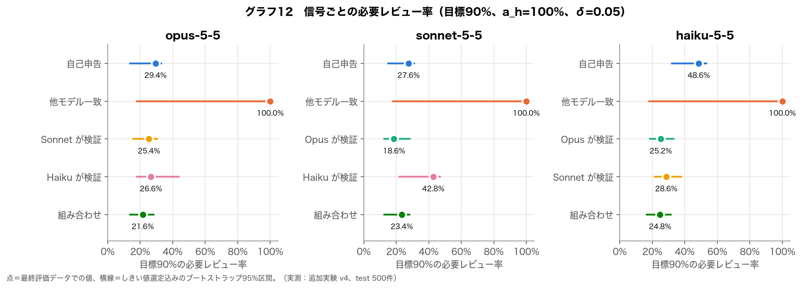

---

## 25. v4 で分かったこと

- **同じ予測（正答率76.2%）のまま、Opus の検証で振り分けると、Haiku の必要レビュー率は48.6%→24.8%**
  - 正答率が同じでも、必要な人手は振り分け方で半分になりうる
- 検証は**対象より強いモデル**で。弱いモデルの検証は自己申告より悪い
- 「複数のAIが一致したら正しい」は危険：3モデル一致408件のうち41件は同じ誤り
- Haiku＋Opus 検証（33.3円）は Opus 単独（39.5円）より安かった【探索的】

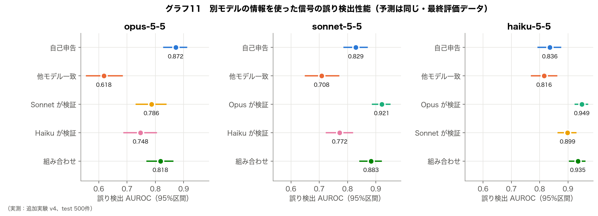

---

## 26. 結論（v1〜v4）

- 確信度順のレビューは、同じ人手でランダムより 6.6〜8.1pt 高い信頼性（v2）
- API単価が最も安いモデルが、目標90%で総コスト最高（約1.7倍、v2）
- 校正の良さ ≠ 誤りを見分ける力（v2）
- 統計的な保証には余裕が要り、それがレビュー量の大部分を占めうる（v2〜v4）
- **正答率がまったく同じでも、強いモデルの検証で振り分けると必要な人手が半分になった（v4、事前に定めた基準を満たす）**
- 同じモデルの再実行や、複数モデルの一致は振り分け信号にならなかった（v3・v4）
- 「正答率だけでなく、レビュー率と総コストで評価すべき」は支持される。モデルの一般的な優劣は断定できない

**次の検証**：「安いモデル＋強い検証モデル」構成を事前登録して確かめる、検証を一部の案件に絞る、人間レビューの実測、実業務のエージェントタスクへの拡張

---

## 27. 追加実験 v5：「安いモデル＋強い検証」は本当に安いか

| 構成 | AI正答率 | 必要レビュー率 | 総コスト/件 |
|---|---|---|---|
| Opus 単独 | 87.2% | 27.8% | 37.3円 |
| Sonnet 単独 | 85.4% | 26.8% | 35.9円 |
| Haiku 単独 | 79.2% | 48.4% | 64.5円 |
| **Haiku＋Opus 検証** | 79.2% | 23.4% | 31.4円 |
| Haiku＋Opus 検証（一部） | 79.2% | 48.4% | 64.6円 |
| Sonnet＋Opus 検証 | 85.4% | 18.2% | 24.6円 |

（目標90%、a_h=100%、test は新しい500件、費用 $2.81）

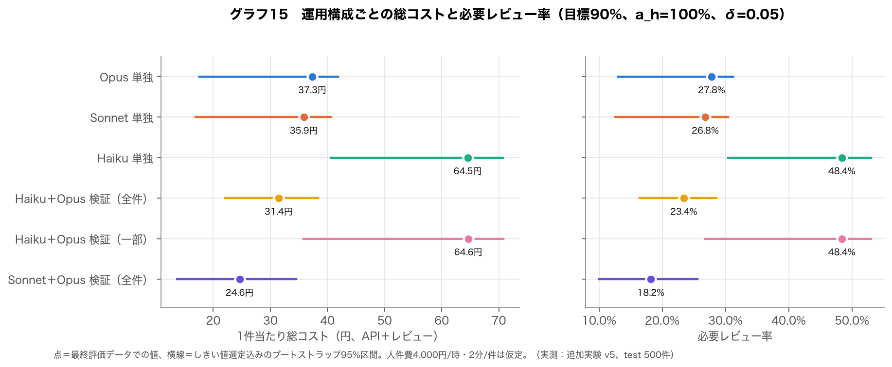

---

## 28. v5 の判定と分かったこと【実測】

| 仮説 | 判定 |
|---|---|
| H1 Haiku＋Opus 検証 < Opus 単独（総コスト、主仮説） | 判定保留（差 +1.9円、−10.4〜+13.8） |
| H2 Haiku＋Opus 検証は保証を満たす | **支持** |
| H3 検証を一部に絞ってもレビューはほぼ増えない | 判定保留（+23.3pt、実質効果なし） |
| H4 v4 の再現 | **支持**（−23.7pt） |
| H5 Sonnet でも Opus 検証でレビュー減 | 判定保留 |

- 点推定（31.4円 対 37.3円）だけを見ると「16%安い」と言えてしまう → **構成の比較は区間で**
- 弱いモデルが**自信を持って間違える**案件こそ検証が必要。弱いモデルの確信度で対象を絞ると効果が消える
- 強いモデルの検証効果（Haiku −23.7pt）は再現

---

## 29. 結論（v1〜v5）

- 確信度順のレビューは、同じ人手でランダムより 6.6〜8.1pt 高い信頼性（v2）
- API単価が最も安いモデルが、目標90%で総コスト最高（約1.7倍、v2）
- 校正の良さ ≠ 誤りを見分ける力（v2）
- 統計的な保証には余裕が要り、それがレビュー量の大部分を占めうる（v2〜v5）
- **正答率がまったく同じでも、強いモデルの検証で振り分けると必要な人手が半分になった（v4、v5 で再現）**
- 同じモデルの再実行や、複数モデルの一致は振り分け信号にならなかった（v3・v4）
- 「安いモデル＋強い検証」は強いモデル単独と同程度の総コストで保証を満たしたが、安いとは言えなかった（v5）
- 「正答率だけでなく、レビュー率と総コストで評価すべき」は支持される。モデルの一般的な優劣は断定できない

**次の検証**：構成の差を見分けるための規模の見積もり、人間レビューの実測、実業務のエージェントタスクへの拡張

---

## 30. 構成の差を見分けるには何件要るか【探索的・API 費用なし】

見分けられる最小の総コスト差（両側5%・検出力80%、v5 の予測を母集団とみなした再標本化）

| 比較 | 500件 | 2,000件 | 4,000件 | 16,000件 |
|---|---|---|---|---|
| Haiku＋Opus 検証 − Haiku 単独（差 約33円） | 21.9円 | 5.3円 | 3.0円 | 1.4円 |
| Sonnet＋Opus 検証 − Haiku＋Opus 検証（差 約4円） | 10.9円 | 7.5円 | 7.5円 | 7.5円 |
| Haiku＋Opus 検証 − Opus 単独（差 約4円） | 21.3円 | 22.1円 | 21.9円 | 14.8円 |

- 差の大きい比較は数百件で足りる
- **自己申告で振り分ける構成が絡むと、件数を増やしても見分けられない**：確信度の段差（0.6→0.7でレビュー率15.4%→27.8%）のどちらが選ばれるかが入れ替わり続ける
- 件数より先に「信号を細かくする」「曲線全体で比べる」「しきい値を事前に固定する」

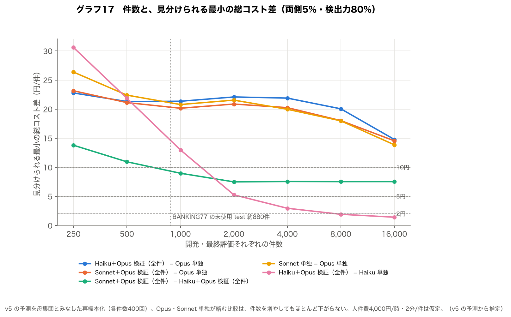
